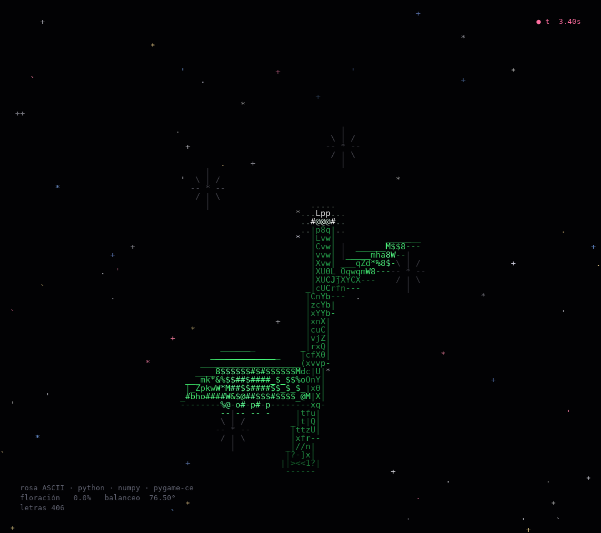
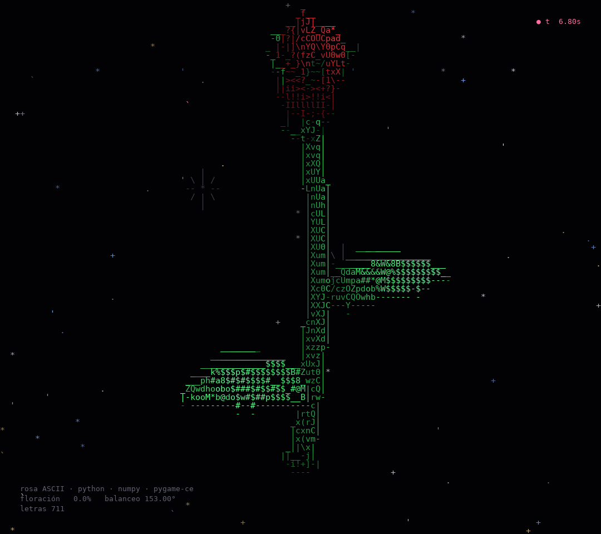
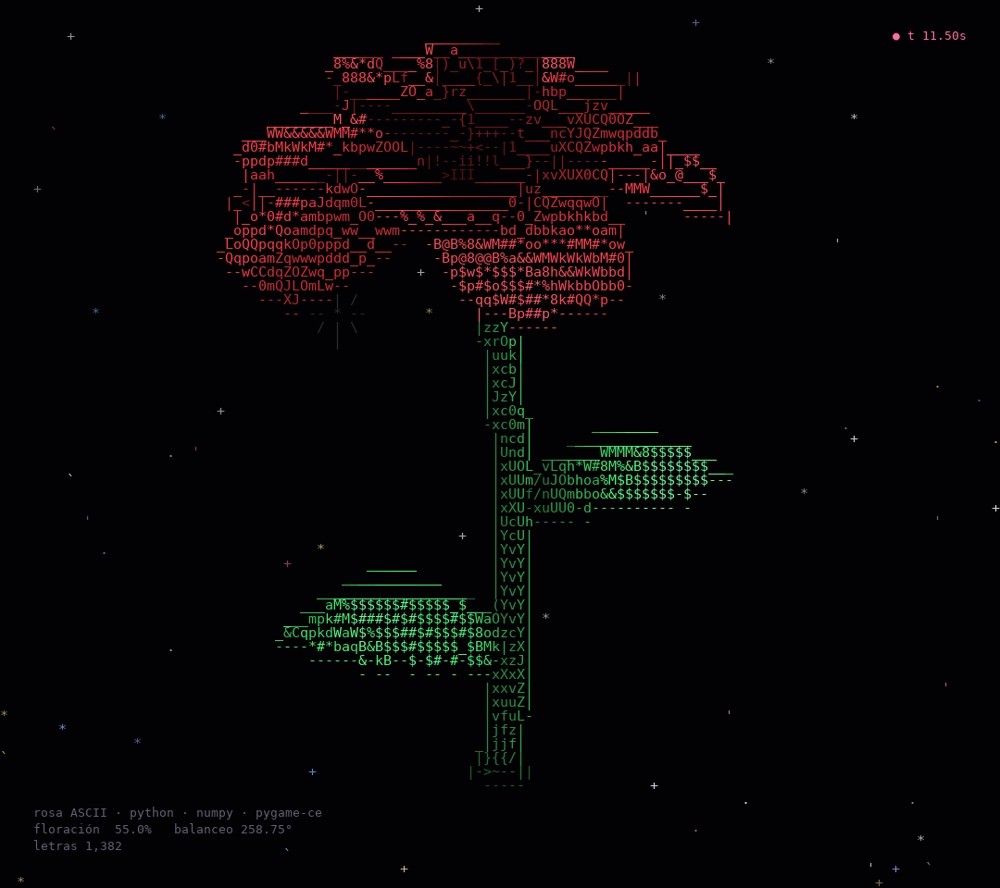
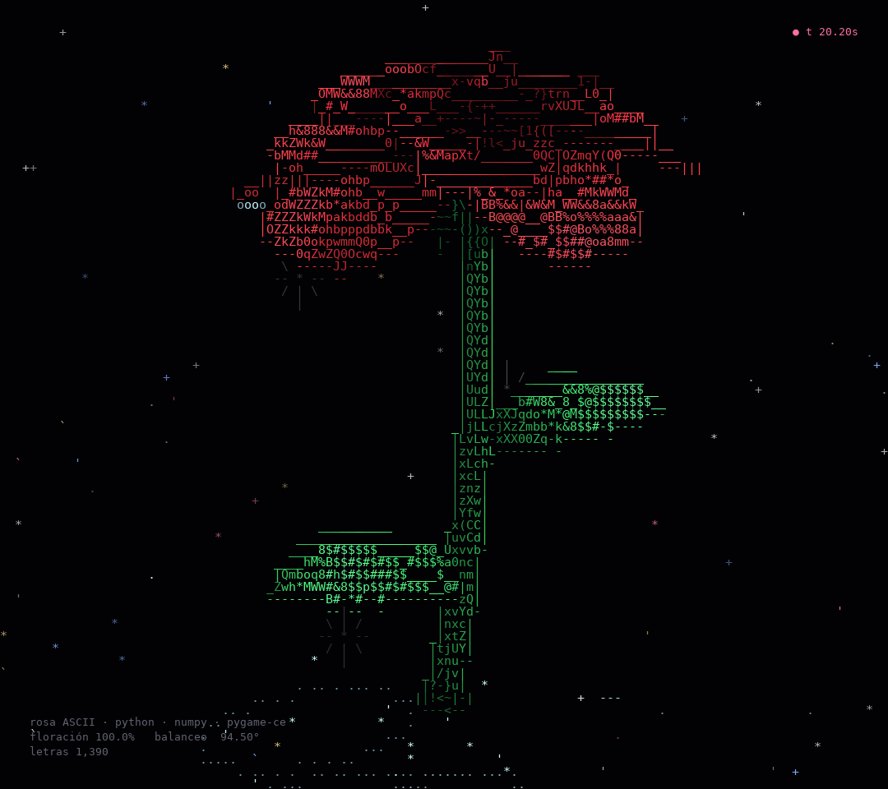

# Rosa ASCII animada

Una rosa 3D que crece, florece y suelta rocío, dibujada solo con caracteres.
Python · NumPy · pygame-ce (o directamente en la terminal).

| 1. Crecimiento | 2. Capullo | 3. Floración | 4. Flor abierta con rocío |
|---|---|---|---|
|  |  |  |  |

## Ejecutar

El entorno virtual ya está en `.venv/` (NumPy y pygame-ce instalados). Desde esta carpeta:

```sh
.venv/bin/python rosa_ascii.py                       # ventana pygame (si no hay pantalla, usa la terminal)
.venv/bin/python rosa_ascii.py --modo terminal       # animación en la terminal (ANSI de 24 bits)
.venv/bin/python rosa_ascii.py --png rosa.png --t 16 # un fotograma como imagen
.venv/bin/python rosa_ascii.py --texto --t 16        # un fotograma como texto
```

En otra máquina: `python -m venv .venv && .venv/bin/pip install -r requirements.txt`.

**Este servidor no tiene pantalla**, así que la ventana de pygame solo se puede abrir en un equipo con escritorio.
Aquí funcionan `--modo terminal` (por SSH) y `--png`.

Teclas en pygame: `ESC` salir · `ESPACIO` pausa · `R` reiniciar · `←`/`→` ±1 s · `+`/`-` velocidad.

Opciones útiles: `--inicio SEG` (arrancar en un momento, p. ej. `--inicio 16` para ver la flor abierta),
`--velocidad 2`, `--fps 30`, `--sin-color`, `--sin-bucle`, `--ancho/--alto` (tamaño de la ventana),
`--aspecto` (alto/ancho de una celda de la terminal, 2.0 por defecto).

## Cómo está hecho

1. **Forma.** El tallo (tubo con curva), las hojas (superficies con borde aserrado), los sépalos y el capullo se
   generan como nubes de puntos 3D con su normal.
2. **Crecimiento** (0–5 s). Un punto de luz sube dibujando el tallo; las hojas se despliegan cuando pasa. Después el
   capullo se llena (4,6–7,4 s).
3. **Floración** (7,5–15 s). Los pétalos son **una sola superficie espiral** (`Planta.rosa_malla`): a lo largo de la
   espiral cambian el radio, el largo y la curvatura del pétalo. Una abertura por capa, con retraso, hace que
   **abran primero los pétalos de afuera**; los de adentro se quedan en copa.
4. **Movimiento.** Balanceo suave del tallo (fase de 360° cada 16 s) con los pétalos rezagados según su distancia
   al centro; gotas de rocío que se hinchan en el borde de un pétalo o de una hoja, caen con gravedad y salpican
   con un anillo de ondas y gotitas.
5. **Render ASCII** (`Renderizador.fotograma`). Proyección en perspectiva, z-buffer sobre subceldas 2×2, luz difusa +
   especular, oclusión simple (los pétalos se oscurecen hacia la base), y cada celda se convierte en un carácter
   según su brillo (`RAMPA`). Los **contornos** (`- | / \ _`) salen de los saltos de profundidad entre celdas vecinas.
   El fondo son estrellas que titilan y algunos destellos tenues.

A los 30 s la planta se deshace poco a poco y el ciclo vuelve a empezar (`--sin-bucle` la deja quieta).

## Ajustes

Las constantes están arriba en `rosa_ascii.py`: tiempos (`T_CRECE`, `T_FLORECE_INI/FIN`, `T_CICLO`), la rampa de
caracteres (`RAMPA`), los colores (`PETALO_INT/EXT`, `VERDE_*`) y la luz (`LUZ_DIR`). La forma de los pétalos está en
`Planta.rosa_malla` (`self.petalos`, `self.vueltas`, `self.tam_flor`, ángulos `a0o/afo`).
